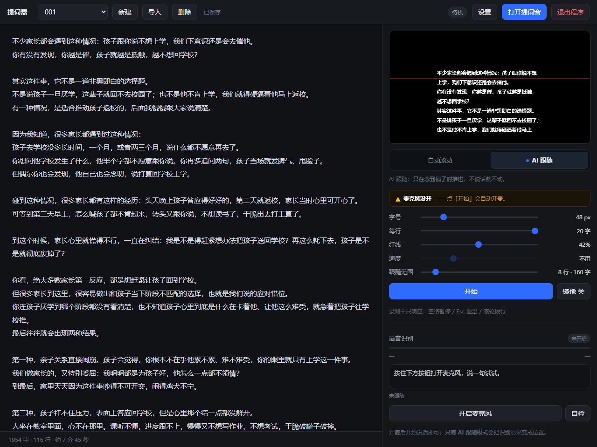
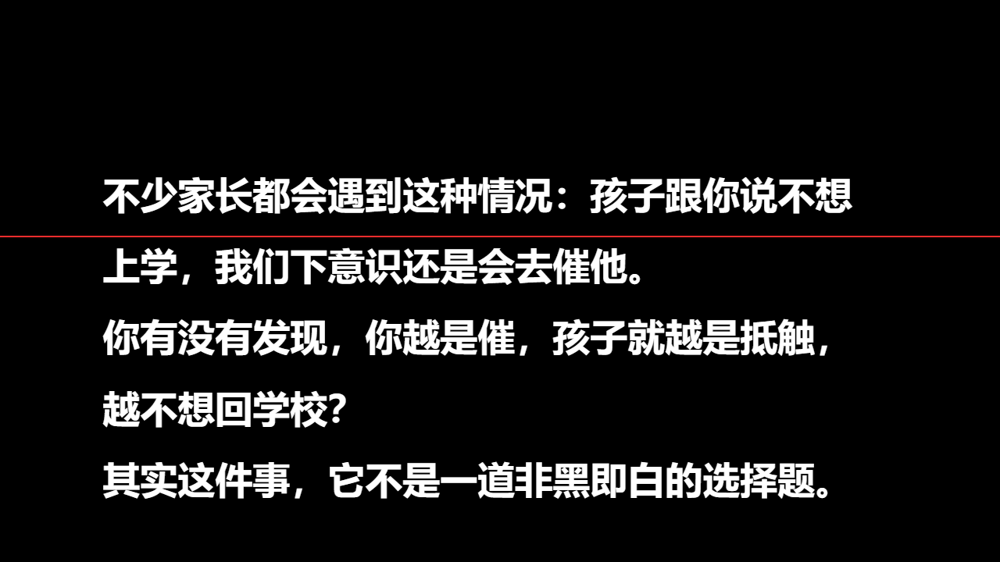
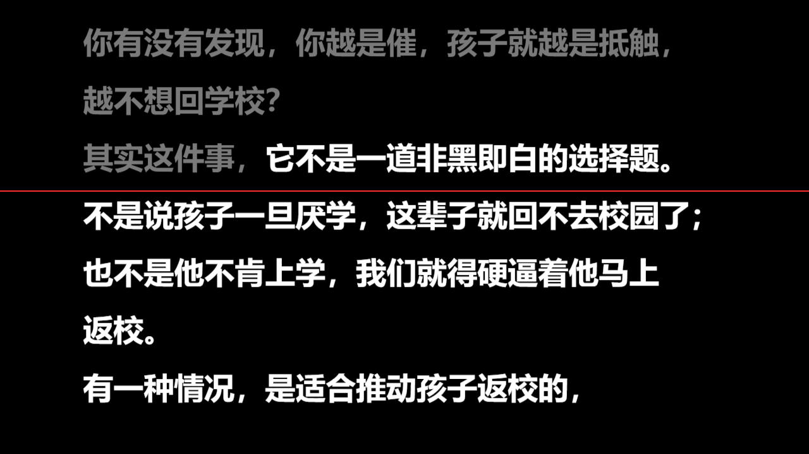
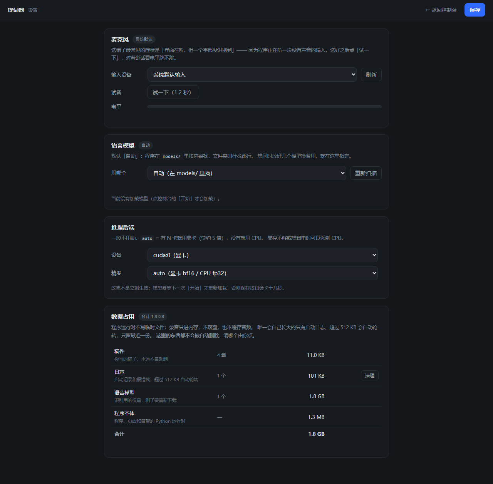

# ai-follow-teleprompter

[中文](README.md) | **English**

**The mic listens to you read, and the script follows your voice.** No scrolling by hand, no remote, no second person holding the page.

Built for recording talking-head videos. Everything runs locally: the model lives on your own GPU or CPU — **no network, no cloud API**, your script never leaves the machine.

| | |
|---|---|
| Current version | **v2.4.0** |
| Platform | Windows 10 / 11 (64-bit) |
| License | [AGPL-3.0](LICENSE) |
| Speech model | [Qwen3-ASR-0.6B](https://github.com/QwenLM/Qwen3-ASR) (Apache 2.0, separate work) |
| Installer size | 13 MB (model and torch are downloaded during setup) |

> **The app's UI is in Chinese.** Every label quoted below is given as `中文 (English)` so you can find it on screen.
>
> The full development log is in [`docs/AI提词器-开发规划-v2.0.md`](docs/AI提词器-开发规划-v2.0.md) — dead ends and rejected designs included, published as-is. It is written in Chinese.
> The follow-range feature was rebuilt four times; that's §21. Disk hygiene is §22.
> The not-yet-built **separate window** is planned in [`v2.3`](docs/AI提词器-开发规划-v2.3.md) (target 2.5.0).

---

## What changed in this version (v2.4.0)

**In one line: "Follow range" replaces "max follow speed".**

| | v2.3.0 | v2.4.0 |
|---|---|---|
| Slider | Max follow speed | **Follow range** |
| Unit | lines / second | **lines** (the real character count is printed next to it) |
| Governs | how **fast** to get there | whether to go **at all** |
| When out of range | slides there slowly | **doesn't move a single line**, and tells you how far off you are |

Limiting by speed was wrong: it still goes there, just slower — the text creeps across the screen and still looks "uncontrolled".
Limiting by range means matches outside the window never become candidates. Full reasoning and the four rewrites are in dev log §21.

Three real bugs fixed along the way:

- **Cross-window fragments were followed by "hugging the edge"**: when the first half of a sentence is inside the
  range and the second half outside, the program took it as a successful match and pushed the view to the range
  edge — so the next tick's real target was inside the range. Two ticks (0.6 s) completed one big jump, looking
  exactly like nothing was limited. It now recognises "this sentence was not found in full" and discards that tick
- **Too small a range stalled following entirely**: when the radius is shorter than one sentence, matching fails
  silently, the screen freezes and nothing explains why. So "Follow range" has a floor of 3 lines
- **`undefined 行/秒` on the panel**: a key was renamed but the browser was still running old JS. Static assets are
  now never cached, and the page notices when it is stale and asks you to reload

Old settings migrate automatically — you don't need to delete `state.json` by hand.

---

## Contents

- [What changed in this version (v2.4.0)](#what-changed-in-this-version-v240)
- [Which one to install](#which-one-to-install)
- [First launch](#first-launch)
- [What it looks like](#what-it-looks-like)
- [Two ways to advance (pick one)](#two-ways-to-advance-pick-one)
- [Follow range: only search a few lines around you](#follow-range-only-search-a-few-lines-around-you)
- [The speech model: which one the author uses](#the-speech-model-which-one-the-author-uses)
- [Settings: change mic, change model](#settings-change-mic-change-model)
  - [Microphone](#microphone)
  - [Speech model](#speech-model)
  - [Inference backend](#inference-backend)
  - [Disk usage: what's taking space, at a glance](#disk-usage-whats-taking-space-at-a-glance)
- [Managing scripts](#managing-scripts)
- [Keyboard shortcuts](#keyboard-shortcuts)
- [Troubleshooting](#troubleshooting)
- [Run from source](#run-from-source)
- [Project layout](#project-layout)
- [Development and self-checks](#development-and-self-checks)
- [How it works](#how-it-works)
- [Known limitations](#known-limitations)
- [License](#license)
- [Credits](#credits)

---

## Which one to install

### Recommended: the installer

Download **`AITeleprompter-2.4.0-Setup.exe`** (13 MB) from [Releases](../../releases) and double-click it.

The installer asks you four things:

| Step | What it means |
|---|---|
| Install location | Defaults to `%LOCALAPPDATA%\Programs\AITeleprompter` — **any drive works**. Reusing the previous folder reuses already-downloaded dependencies; a new folder downloads again |
| Runtime | **GPU accelerated** (pick this if you have an NVIDIA card) or **CPU only**. The difference is the 2.6 GB vs 240 MB below |
| Extra tasks | Tick "create a desktop shortcut"; ticking "download the model now" is optional — you can do it later |
| Start install | A separate progress window appears — **it can be paused and cancelled**, and its minimise and close buttons really work |

How much it downloads (one time, stored locally):

| What | GPU accelerated | CPU only |
|---|---|---|
| PyTorch (the engine that runs the model) | ~2.6 GB | ~240 MB |
| Speech model Qwen3-ASR-0.6B | 1.8 GB | 1.8 GB |

The rules you'll actually need:

- **Cancelling doesn't waste the download.** Half-fetched packages stay put; running the installer again resumes and **only fetches the missing part**.
- **Reinstalling / upgrading is the same**: it inspects what is already on the machine and skips whole steps — if torch is the right version it won't download 2.6 GB again.
- **Close the teleprompter before installing.** If it's running, the installer tells you once ("please quit the teleprompter") because the Python runtime files are locked. There is a **Quit (退出程序)** button at the top right of the console; if you can't find the console, end `pythonw.exe` in Task Manager.
- When it finishes you can hit "launch now", or tick "view install result" for a few-hundred-byte summary.

**Uninstall**: Windows Settings → Apps → "AI 提词器". It **asks you twice, separately**: whether to delete your scripts and UI settings, and whether to delete the 1.8 GB model. Both default to No.

### Or skip the installer: run from source

You need Python 3.10+ on the machine (tested on 3.13). See [Run from source](#run-from-source).

---

## First launch

Double-click **"AI 提词器"** on the desktop. About a second later the browser opens `http://127.0.0.1:8756` by itself.

> **No black console window — that's normal.** It starts through `pythonw.exe`, which doesn't allocate a console.
> Judge "is it up?" by whether the page opened, not by whether a black box appeared.

**How to shut it down**: the red **Quit (退出程序)** button at the top right of the console page. The server stops immediately, the process exits, the page gets a "the teleprompter has quit" overlay and you can close the tab.

> It used to mean Task Manager and `pythonw.exe`. This button replaces that step.

The smoothest daily path: paste the script → pick how it advances → click **Open prompter (打开提词窗)** → drag the prompter window to the screen near your camera → press Space to start.

---

## What it looks like



Your script on the left, a 16:9 live preview and every control on the right. The segmented switch at the top decides
**who pushes the text**; the bottom slider in the right-hand column is **Follow range (跟随范围)** — it governs whether
the AI follows a wild jump, and it [has its own section](#follow-range-only-search-a-few-lines-around-you).

The prompter has two states — **ready** (all white, the red line rests under the first line) and **following**
(everything already read turns grey):

| Ready | Following |
|---|---|
|  |  |

Black background, white text, one red line under the line you're on:

- Above the red line = already read, all grey → a glance tells you where you are
- Below the red line = not yet read, stays white → you can look ahead
- Inside the current line, each character turns grey as you say it

Red line height is adjustable (15%–70%), font size (24–160 px), characters per line (8–20). **All of it locks while
recording**; only Space (pause), Esc (exit) and the wheel (nudge a line) still work — deliberately, so a shaky hand
can't ruin the layout mid-take.

---

## Two ways to advance (pick one)

The switch at the top of the console decides who pushes the text. They are mutually exclusive — never both at once:

| Mode | How the text moves | When to use it |
|---|---|---|
| **Auto-scroll (自动滚动)** | advances at a fixed **speed** (characters/sec), never touches the mic | rehearsal, steady-paced scripts, not wanting the mic on |
| **AI follow (AI 跟随)** | **only moves when it recognises something from the script**; silence means it stays put | recording. Fast or slow, pauses, re-reads — none of it matters |

**AI follow doesn't need you to switch the mic on**: choose the mode and hit **Start (开始)**. The first time takes
10–20 s (import torch + load weights + warm up); the status line shows progress meanwhile, and **the mic is already
open** — what you say during that window isn't lost, it's caught up from the last 4 seconds once loading finishes.
After that, toggling takes 1–2 s (the model is already in RAM).

The mode is remembered; next launch it's still the same.

### Is the AI actually working? Watch that status line

"Text isn't moving" and "the program is broken" look identical from the outside, so in AI mode one line spells out
the situation:

| Status | Meaning | What you should do |
|---|---|---|
| ⚠️ Mic is off | It can't hear you; the text won't move | Click Start — it opens the mic |
| ⏳ Loading the speech engine | 10–20 s the first time | Wait; **don't click Start again** |
| 🎤 Listening, but haven't heard you yet | Engine is ready, no audio arriving | Watch the level meter; if it doesn't move, the mic is muted / silent / wrong device |
| 🎧 Heard you, but can't match the script | It recognised something, but too far from the current position (usually outside Follow range) | **Use the wheel** to bring the current line to where you're reading; if this happens often, raise Follow range |
| ✅ Following · confidence 0.xx | Working normally | — |

---

## Follow range: only search a few lines around you

When a script repeats itself (the same word or sentence two or three times), recognition can match the **distant
copy**, and the text snaps dozens of lines away and back — which looks like "it scrolls wildly and can't find where
I am".

This slider governs exactly that: **AI follow only searches within N lines before and after the current position;
matches outside that range are never followed.** Default **8 lines**; at 20 characters per line that's
**160 characters** (the console screenshot above is that combination — shrink characters per line and the character
count on the right shrinks with it).

The slider prints two numbers: `8 行 · 160 字` ("8 lines · 160 chars"). The first is the line count you set; the second
is the **derived radius in characters**, which is what the program actually uses — so "what the panel says" and "how
far it will really follow" can never drift apart.

| Value | Radius (at 20 chars/line) | Effect |
|---|---|---|
| `3` | 60 chars | Tightest. Anything beyond three lines is refused; you basically step along line by line |
| `8` | 160 chars | Default. Normal reading is unaffected; collisions a dozen lines away are blocked |
| `20` | 400 chars | Loose. Allows fairly large jumps |
| `50` | 1000 chars | Essentially unprotected (on a short script, the whole script counts as "nearby") |

**It has nothing to do with how *fast* it jumps, only with how *far*.** Jumps inside the range are **instant** (no
creeping, no slow slide); outside the range it doesn't move at all — the screen stays put and waits for you to wheel.

The console shows one line, **超出跟随范围 · 差 N 行 · 拨滚轮或调大「跟随范围」** ("outside follow range · N lines off ·
wheel or raise Follow range"), so you can tell "blocked by the range" from "the program hung".

A few notes:

- **Lines, not characters.** The search radius = N × characters per line, so raising "per line" widens the range —
  which matches intuition (you never get "changing two characters per line changed how many lines it can jump")
- **There is a floor: at least 3 lines and at least 40 characters.** Not caution — it breaks without it. One speech
  segment is 20–40 characters, and when the radius is shorter than that sentence, the window can't even hold "the
  sentence you are saying", matching fails outright and the text freezes. Measured at 20 chars/line with range 1
  line (radius 20 chars): fed 900 characters, it followed only the first 20, and because "nothing moved" the UI couldn't even
  report "out of range" — it just looked broken. So the minimum stops at 3 lines
- **A sentence straddling the edge is not followed.** At the moment of a jump, the recognised snippet usually begins
  with what you just read and ends with the distant text — the program recognises "this sentence wasn't found in
  full" and **discards the tick**; the screen stays. Otherwise it would hug the range edge first, and the next tick's
  real distant target would be inside the range: two ticks (0.6 s) complete one big jump, as if nothing were limited
- **No auto-release after several out-of-range ticks.** Recognition fires every 0.3 s, adjacent ticks overlap 95%, so
  one colliding word can report several ticks in a row — leaving that back door open would put the big jump back in
  another form
- **Instant inside the range, no easing.** Deliberate: you asked for "don't follow", not "follow slowly". Easing makes
  the text creep continuously, which feels worse
- **Only meaningful in AI follow mode**; in auto-scroll the slider is greyed out and reads `不用` ("unused")
- **Locked while recording**, like font size / per line / red line / speed — set it in the ready state
- **The wheel is unaffected**: to jump ahead, use the wheel — manual override always wins, and it re-anchors afterwards

> A side note: v2.3.x implemented "at most N lines per second" speed limiting, and it was later thrown out.
> Speed limiting **still goes there**, just slower — you watch the text slide across and still feel "it isn't
> controlled". Your own words were "don't follow the parts that jump too far" — that's a distance problem, not a
> speed problem.

---

## The speech model: which one the author uses

**The recommended external dependency is the speech recognition model:
[`Qwen3-ASR-0.6B`](https://github.com/QwenLM/Qwen3-ASR).** Recommended only — others can work too, see below.

| Item | Value |
|---|---|
| Full name | Qwen3-ASR-0.6B |
| Made by | Alibaba Tongyi Qianwen team (Qwen) |
| License | **Apache 2.0** (commercial use, modification and redistribution allowed; keep the copyright and licence notices) |
| Parameters | 0.6B |
| Weight size | ~1.8 GB across 10 files (`model.safetensors` alone is 1.75 GB) |
| Download | [ModelScope](https://modelscope.cn/models/Qwen/Qwen3-ASR-0.6B) (fast in China) / [Hugging Face](https://huggingface.co/Qwen/Qwen3-ASR-0.6B) |
| Where it lives | `models/Qwen3-ASR-0.6B/` (under the install directory's `models\` for the installer build) |

> In theory any model works — load whatever suits your hardware. Very small models tend to be embarrassingly slow at
> recognition; I haven't tested other models' compatibility much, but by now most people have an agent like WorkBuddy
> or DSH, and a sentence or two will do the job.

### ⚠️ The easiest thing to confuse: the model and torch are two different things

| | What it is | Size | Role |
|---|---|---|---|
| **Model** `Qwen3-ASR-0.6B` | a pile of **data files** (`model.safetensors` plus 9 others) | 1.8 GB | holds the knowledge of "Chinese speech → text" |
| **torch** (PyTorch) | a **software engine**, an ordinary Python library | ~2.6 GB | the compute framework that runs the model; it knows no language at all |

So "switch to the CUDA build of torch" = **swap the engine** (compute on the GPU instead of the CPU) — **not one byte
of the model changes**. They version independently: the model is `Qwen3-ASR-0.6B`, the engine is `torch==2.14.0+cu126`
— `+cu126` means "compiled against CUDA 12.6". Without an NVIDIA card you install the CPU build of torch and **still
run the same model**, just about 5× slower.

### Why the weights aren't in this repo

`model.safetensors` alone is 1.75 GB, while **GitHub's hard limit per file is 100 MB**, so pushing it always fails.
That's why `.gitignore` excludes `models/` and the weights are downloaded separately — **not hiding anything, just a
platform limit**. The installer downloads them straight into the install directory, never through the repo.

### Nothing outside recognition uses a model

No LLM, no cloud API, no account. What is called "AI follow" is constrained alignment (pinyin + semi-global DTW)
between **the script you already know** and **the recognised text**, which locates far more precisely than generic
speech recognition — measured at 0.66 ms per call. See [How it works](#how-it-works).

---

## Settings: change mic, change model

Top right of the console → **Settings (设置)**. Change things and click **Save (保存)**; they take effect on the **next
Start**. While recognition is running the whole page is locked, the same rule as "can't delete a script while
recording": you don't yank out something that is in use.



Top to bottom, four blocks: **Microphone → Speech model → Inference backend → Disk usage**. The first three are
covered below; the last one (the bottom of the screenshot) has
[its own section](#disk-usage-whats-taking-space-at-a-glance).

### Microphone

The dropdown lists every recording input on the system; "(system default)" is whatever Windows currently defaults to.

Not sure which to pick? **Click "试一下 (Try it)"** and watch the level meter while you talk:

| Level | What it means | What to do |
|---|---|---|
| Barely moves (< 0.002) | This device is hearing nothing | Wrong device / mic muted / not plugged in |
| 0.002 – 0.02 | There's sound, but it's quiet | Move closer while recording, or raise the input volume in Windows |
| > 0.02 | Normal | Use it |

This table solves the most annoying case: **"it's listening" and "it can't hear me" used to look identical in the
UI**, leaving you to guess. Now you can see it on the spot.

### Speech model

The default is "auto" — the program **looks by content** inside `models/`, ignoring folder names:

```
models/Qwen3-ASR-0.6B/           ← default location, preferred
models/whatever-you-call-it/     ← renaming is fine
models/downloads/Qwen3-ASR-0.6B/ ← an extra folder from unzipping is fine
models/                          ← dumping the files straight in is fine too
```

It checks exactly two things: that the folder **contains both** `config.json` and a weight file
(`model.safetensors` / `pytorch_model.bin` / sharded `model-*-of-*.safetensors`).

To keep several models around: put them all in `models/` and they'll be listed here to choose from; or pick
"manually specify a path…" and give an absolute path outside `models/`.

> To pin weights stored elsewhere, you can also set the `TELEPROMPTER_MODEL` environment variable to that directory —
> once set, it is the only one used.

### Inference backend

Usually nothing to change. `auto` = use the GPU if there's an NVIDIA card (about 5× faster), otherwise CPU. If VRAM is
short, or you want a quiet low-power run, force `cpu`.

> **Saving doesn't load the model right away**: that would freeze the UI for 10–20 s (importing torch) and look like a
> hang. So it only stores the parameters; the actual switch happens at the next **Start**. Same for the mic.

### Disk usage: what's taking space, at a glance

The bottom block of the settings page (the very bottom of the full-page screenshot above). Four rows — scripts, logs,
speech model, program itself — adding up to the whole footprint, each row noting whether it grows.

**The short version: this program writes almost no temporary files at runtime.** Audio stays in memory (a ring
buffer), never hits the disk, never cached — so "one recording, a pile of files" doesn't happen. The only thing that
grows on its own is the launch log:

| Item | Does it grow? | Notes |
|---|---|---|
| Scripts | only as you write more | **your property, never auto-deleted** |
| Logs | capped | rotates at 512 KB per file, one kept, total ≤ ~1 MB |
| Speech model | no | 1.8 GB of weights; deleting them means downloading again |
| Program itself | no | code, pages and the bundled Python runtime (excluding the two above) |

- This page **only measures and displays; it never deletes anything on its own**. You choose what to clean
- "Clean (清理)" appears only on the log row, and **deletes `.log` files only** — not one character of your scripts
- If the log is held open when you clean it, it falls back to **truncating** it, which still starts from zero
- The installer's download cache (`_tmp/`, holding torch's 240 MB) is removed by the installer when it finishes; if
  permissions prevent that, an extra "install cache" row shows up here for you to clean manually

---

## Managing scripts

Scripts live in `data/scripts/`, one `.md` per script. Four things in the UI:

| Action | How |
|---|---|
| New (新建) | header button; type a name |
| Import (导入) | header button; pick `.txt` / `.md`, the filename becomes the script name |
| Delete (删除) | header button; deletes the selected script |
| Edit | type in the left pane; it auto-saves 0.8 s after you stop |

Before deleting, the confirmation shows the name and character count — **this cannot be undone and there is no
recycle bin**. Two safeguards:

- **You can't delete while recording** (the button is locked): having the content you're reading vanish mid-take is dangerous.
- If you delete the current script it switches to the first remaining one; delete them all and the sample script comes back.

> Script names can't contain `/ \ : * ? " < > |` and can't start with a dot — those don't produce legal filenames
> and, worse, can escape `data/scripts/`. The backend refuses them.

**Moving to a new machine / reinstalling: the only things you need are `data/`** (scripts and UI settings) and
`models/` (the model).

---

## Keyboard shortcuts

| Key | When | Action |
|---|---|---|
| `Space` | ready | start |
| `Space` | recording | pause / resume |
| `Esc` | recording | back to ready |
| Wheel | recording | nudge the current line up / down by one |
| `Ctrl` + `=` / `-` | ready | font size ±2 |
| `F11` | anywhere | fullscreen |

Ready-state shortcuts are blocked while recording — that boundary is the anti-mistouch mechanism.

---

## Troubleshooting

### Check these three first

| File | Where | What it is |
|---|---|---|
| `install-result.txt` | install dir root | install summary (a few hundred bytes); "view install result" opens it in Notepad |
| `install.log` | install dir root | the whole install log; download and pip details are in there |
| `data\launch.log` | `data\` under the install dir | **appended on every launch**: which interpreter, which directory, console or not. When "double-clicking does nothing", read this first |

### Common cases

| What you see | The real cause | What to do |
|---|---|---|
| Double-clicking the shortcut shows **no console** | Normal: `pythonw.exe` doesn't allocate one | Check whether the browser opened `http://127.0.0.1:8756` |
| No browser, but the program seems to be up | Default browser not associated, or blocked | Open `http://127.0.0.1:8756` yourself; in this case the program also pops up the address |
| Double-clicked, **nothing happens at all** | It failed during startup and pythonw has no stderr | Look at the end of `data\launch.log` — the full traceback is there; when it truly can't start it shows a dialog with the reason |
| The installer says "AI 提词器 is running" | The program is still open; Python runtime files are locked | Click **Quit** in the console, or end `pythonw.exe` in Task Manager, then OK |
| The installer says "looks like it's still running" but you closed it | The previous process hasn't fully exited | Click Next again to retry |
| Port 8756 is taken | An earlier instance didn't exit cleanly | Close every instance and retry; or set `TELEPROMPTER_PORT=8757` |
| UI opens, but Start reports missing torch / model | Engine or weights aren't in place | Re-run the installer (it fills the gaps); or check the model directory per [Settings](#settings-change-mic-change-model) |
| UI is fine, but the text won't move | See [Is the AI actually working](#is-the-ai-actually-working-watch-that-status-line) | Nine times out of ten: mic off, mic silent, or you're reading far from the current position |
| Installed but won't open, and you want a clean slate | — | Uninstall and reinstall; `data\` and `models\` are asked about separately and stay unless you delete them |

> 💡 **The UI and the speech stack are two layers — don't debug them as one.**
> `fastapi` / `uvicorn` / `numpy` / `sounddevice` / `pypinyin` / `websockets` are the floor for "the UI opens";
> `torch` / `transformers` / `qwen-asr` are imported only when you hit Start and load the model.
> So "the UI won't open" and "Start does nothing" are different problems pointing in different directions.

---

## Run from source

For people who don't want the installer, want to change the code, or want to package it for someone else.

**Prerequisites**: Windows 10/11 + Python **3.10+** (tested on 3.13).

```bash
git clone https://github.com/BBsaba/ai-follow-teleprompter.git
cd ai-follow-teleprompter

# 1) dependencies (a virtualenv is recommended, don't pollute the system Python)
python -m venv .venv
.venv\Scripts\activate
pip install -r requirements.txt

# 2) model weights (1.8 GB, resumable — just re-run if interrupted)
python tools/download_model.py

# 3) start
python run.py        # or double-click start.bat
```

`start.bat` looks for an interpreter in order: `.venv\Scripts\python.exe` → the `TELEPROMPTER_PYTHON` environment
variable → `python` on PATH. The first line prints which one it picked.

### The two torch builds

`torch>=2.4` in `requirements.txt` installs the **CPU build** from PyPI (measured RTF 0.30, perfectly usable). For GPU
acceleration, install the CUDA build with the command [pytorch.org](https://pytorch.org) gives you, for example:

```bash
pip install torch --index-url https://download.pytorch.org/whl/cu126
```

| Build | Size | 4 seconds of audio | For |
|---|---|---|---|
| **CUDA 12.6** | ~2.6 GB | ~0.24 s (RTF 0.06) | NVIDIA GPUs |
| **CPU** | ~240 MB | ~1.2 s (RTF 0.30) | any machine; slower but enough |

The dev machine is an RTX 3060 Ti 8 GB + CUDA 12.6; the first row is measured there. Picking wrong isn't fatal:
`config.ASR["device"] = "auto"` tries cuda first and silently falls back to cpu.

> ⚠️ **The pins in `requirements.txt` are intentional — don't upgrade them by hand.**
> `transformers==4.57.6` / `huggingface-hub<1.0` / `qwen-asr==0.0.6` are tightly coupled;
> loosening any one of them triggers `check_model_inputs` or a version conflict. The painful details are in dev log §11.4.

### Desktop shortcut (optional)

```bash
python tools/make_shortcut.py                 # current user's desktop, no console window
python tools/make_shortcut.py --with-console  # points at start.bat, keeps the console for debugging
python tools/make_shortcut.py --show          # show what it points at right now
python tools/make_shortcut.py --remove        # delete it
python tools/make_shortcut.py --all-users     # public desktop (needs admin)
```

By default it points at **`pythonw.exe` + `run.py`**, so double-clicking shows no console — the same launch path as the
installer.
Interpreter lookup matches `start.bat`: `.venv\Scripts\pythonw.exe` → `pythonw.exe` next to `%TELEPROMPTER_PYTHON%` →
next to the current interpreter. Only when none is found does it fall back to `start.bat` (which does show a console).

**No `pip install pywin32` needed**: `tools/win_shortcut.py` calls Windows' `IShellLinkW` / `IPersistFile` through
ctypes — the same API Explorer itself uses.

> A mistake from-source users often make: run `make_shortcut.py`, then hand-edit the shortcut to point at another
> interpreter. Don't — `--show` tells you exactly which `pythonw.exe` it points at.

The icon `assets/teleprompter.ico` is generated by `tools/make_icon.py` (needs pillow, only when generating):
black background, three white lines, one red line — the prompter itself.

### Packaging it for someone else

Two routes, **two different artefacts**; the only difference is whether the model is inside:

```bash
python tools/package.py                # → dist/AITeleprompter-<date>-code.zip    ~250 KB
python tools/package.py --with-model   # → dist/AITeleprompter-<date>-full.zip    1.8 GB
```

`--list` shows what would be packed without writing a zip. It **excludes `data/`** (your scripts and preferences)
automatically; add `--include-data` if you really want to ship them.

**Send `full` to people**: they unzip → double-click `setup.bat` (creates the venv, installs dependencies) →
double-click `start.bat`. The model is already inside, so nothing is downloaded; the only requirement is Python 3.10+.

---

## Project layout

```
ai-follow-teleprompter/
├── app/                    backend
│   ├── config.py           every tunable number lives here
│   ├── script.py           script parsing: clean → split into lines → phonetic annotation
│   ├── session.py          state machine + position advance
│   ├── motion.py           position smoothing (asymmetric low-pass)
│   ├── align.py            pinyin + semi-global DTW aligner
│   ├── audio.py            mic capture (16 kHz ring buffer) + device enumeration / test tone
│   ├── asr.py              Qwen3-ASR inference wrapper
│   ├── model_finder.py     finds model dirs by content (no hard-coded paths)
│   ├── listener.py         sliding-window loop: audio → recognition → broadcast
│   ├── store.py            scripts and settings persistence
│   ├── storage.py          disk usage accounting + cleaning (whitelist only, never touches scripts)
│   ├── shutdown.py         the quit switch (the only exit for /api/quit)
│   └── server.py           FastAPI + WebSocket
├── web/                    frontend (plain JS, zero build step)
│   ├── console.*           console
│   ├── prompter.*          prompter window
│   └── settings.*          settings page
├── installer/              installer sources
│   ├── AI提词器.iss        Inno Setup script (pages, components, Pascal logic)
│   └── check_iss_comments.py  lints the .iss: will Chinese comments garble the installer text
├── tools/
│   ├── build_installer.py  builds the installer (portable Python + pip + ISCC)
│   ├── prep-ui.ps1         the progress window during install (PowerShell + WinForms)
│   ├── pip_progress.py     runs pip for the installer, writes a percentage into a status file
│   ├── check_env.py        pre-flight check, decides which steps can be skipped whole
│   ├── download_model.py   resumable weight download
│   ├── package.py          zip packaging (code version / with-model version)
│   ├── make_icon.py        generates assets/teleprompter.ico (needs pillow)
│   ├── win_shortcut.py     creates .lnk files: ctypes → IShellLinkW, no pywin32
│   └── make_shortcut.py    create / inspect / remove the desktop shortcut (defaults to pythonw)
├── models/                 model weights (not in git, 1.8 GB)
├── data/                   your scripts and preferences (not in git)
├── docs/                   the full development log + screenshots used by the READMEs
├── tests/                  script-style tests, single entry point run_all.py
├── assets/teleprompter.ico
├── run.py                  entry point
├── setup.bat               first-time source install: create .venv + install deps
├── start.bat               double-click to run from source (keeps the console, so you see errors)
├── LICENSE                 AGPL-3.0
└── requirements.txt
```

**Every path is derived from `ROOT` in `app/config.py`**, so the whole folder runs wherever you put it. The port
defaults to 8756; to run two copies at once (say a freshly unzipped one) set `TELEPROMPTER_PORT`.

---

## Development and self-checks

### Running the tests

```bash
python tests/run_all.py          # everything that can run
python tests/run_all.py --fast   # only what needs neither a server nor a model (~15 s)
```

| File | Covers | Needs |
|---|---|---|
| `test_script.py` | cleaning, hard line splitting, Chinese line-break rules, motion smoothing | — |
| `test_align.py` | DTW alignment (exact / missing / extra / jump / noise / punctuation / homophone) + 11 follow-range boundaries + session advance | — |
| `test_server.py` | script-id safety, deletion, whether AI mode opens the mic, storage API | — |
| `test_model_finder.py` | content-based model discovery: renamed, extra nesting, dumped flat, explicit-path strictness | — |
| `test_settings.py` | mic index validation, model path validation, no pointless unload on device change, settings locked while recording, old-state migration | — |
| `test_storage.py` | log rotation / cleaning deletes logs only / startup sweep leaves the pip cache alone / accounting | — |
| `test_follow_e2e.py` | sample audio → recognition → alignment → position | model |
| `test_live.py` | a fake mic into the real loop, to see whether position gets pushed along | model |
| `test_ws.py` | WebSocket protocol, state machine, pause / quit | server running |
| `test_ui.py` | console wiring, red line under the current line, line/character greying, key blocking, AI status line, delete lock | server running + playwright |

Measured: `--fast` **271 checks** (6 files); the full suite **342 checks** (10 files, server required).
`test_ui.py` needs playwright; without it, it's skipped with a reason — one file skipped, the rest still run.

```bash
pip install playwright
python -m playwright install chromium    # once, ~150 MB
```

`run_all.py` checks its own prerequisites, skips with an explanation when something is missing, and **never pretends
to pass**.

> ⚠️ **Don't run `pytest tests/`.** These are script-style tests (they keep their own `OK/FAIL` counters and assert
> through `check()`, with no `assert` statements), so pytest collects them as empty functions and reports
> "14 passed" — a false green. `tests/conftest.py` blocks that explicitly.

### Building the installer

Requires **Inno Setup 6 or 7** (`ISCC.exe`; add `--iscc` if it lives in a non-default location). Everything else is
automatic:

```bash
python tools/build_installer.py --version 2.4.0
```

It does three things:

1. Downloads the Python 3.13 embeddable package, unpacks a portable runtime, installs pip, and writes `python313._pth`
   (**leave out the `..` line and `import app` fails after installation**)
2. Copies `app/ web/ tools/ run.py requirements.txt` into the payload; forces `prep-ui.ps1` to UTF-8 with BOM
3. Calls ISCC to compile; the artefact lands in `dist/`

When iterating on code, add `--skip-runtime` to reuse `build/payload/python` — a build takes seconds.

> The installer **contains no** torch, transformers or model weights — those are downloaded on the user's machine.
> That's why the package is only 13 MB.

> ⚠️ **Rename to ASCII before uploading to a GitHub Release.** `build_installer.py` produces
> `AI提词器-<version>-安装程序.exe` locally, but Release asset names don't accept non-ASCII: Chinese is stripped and
> `AI提词器-2.4.0-安装程序.exe` becomes `AI.-2.4.0-.exe`, and a PATCH rename cannot rescue it (the API returns 200 and
> the name stays). So releases use `AITeleprompter-<version>-Setup.exe` while the local file keeps its Chinese name.
> The two names differing is expected.

---

## How it works

| Stage | Approach | Why |
|---|---|---|
| Line splitting | **hard split by character count**, preferring a break at punctuation within the last 30% of the line, obeying Chinese line-break rules | the red line sits under a line, greying is per line and the wheel moves by line — all three need explicit line boundaries; CSS natural wrapping gives none |
| Rendering | red line fixed, **only the text layer translates** | one `translateY` per frame, no relayout, a steady 60 fps |
| Greying | line level (whole lines above go grey) + character level (current line, character by character) | one glance tells you where you are |
| Screen edges | fade height **computed from line geometry**, covering only the half line cut by the edge | otherwise you get half-cut giant characters at the edges, which looks like a bug |
| Sizing | everything in **ratios**, `ResizeObserver` + rAF coalescing, transitions off while resizing | window drags, F11, a second monitor and 125% scaling must not knock the red line off target |
| Recognition | Qwen3-ASR-0.6B (transformers backend) | strong Chinese, 0.6B is fast enough, Apache 2.0 |
| Alignment | pinyin + semi-global DTW, initial/final-level costs | the script is known, so this is constrained matching — far more precise than generic ASR; measured 0.66 ms per call |
| Range limiting | **the search window *is* the range** (`pos ± N lines`); nothing outside is followed. On a miss a 3× scout window is opened **for judgement only, never for landing** | limiting by distance is what blocks collisions; limiting by speed only makes it slower while it still slides |
| Truncation | when the match path reaches the window's last cell → the tick is discarded | the straddling sentence would be "edge-hugged" as a success, and two ticks (0.6 s) complete one big jump |

---

## Known limitations

- **Position updates ~2–3 times per second** in AI mode (GPU), so character greying moves in "two or three characters
  every half second" rather than character by character — a line takes four or five seconds to read, which is enough,
  but don't expect mouth-synced smoothness.
- **Nothing outside Follow range is ever followed, and there's no back door**: deliberately no "auto-release after
  several out-of-range ticks". After a genuinely big jump the position stays where it is and only the wheel takes over
  (one line per notch, re-anchoring afterwards). Why there's no back door: see
  [Follow range](#follow-range-only-search-a-few-lines-around-you).
- **Editing the script resets the position to character 1** (editing halfway through a rehearsal loses your place —
  a deliberate simplification).
- The editor is plain text: no images, tables or per-speaker colours.
- **The font ceiling is bounded by screen width** — about 127 px at 1080p.
- **Hard line splitting can cut an English word in half**; accepted, since talking-head scripts are mostly Chinese.
- **One model at a time**: switching models means unload + reload, so the first Start takes 10–20 s; two models can't
  stand by together.
- **No mic hot-plug handling**: unplugging the device in use errors on the next open instead of switching to another.
- **16 kHz is preferred**: only if the device doesn't support it does it fall back to the device's own rate and
  resample; there is no manual override.
- **No window in the background** (pythonw). To stop it, use **Quit** in the console; if that ever fails, end
  `pythonw.exe` in Task Manager.

---

## License

**Released under the [GNU Affero General Public License v3.0](LICENSE) (AGPL-3.0).**

```
Copyright (C) 2026 公功供工
```

In one line, what you may do:

| What you want to do | Allowed? | Condition |
|---|---|---|
| Personal use, recording videos (**including commercial videos, product promos, paid courses**) | ✅ Go ahead | none |
| Modify the code, add your own features | ✅ Go ahead | none |
| Use it inside a company or studio | ✅ Yes | none |
| Bundle it and send it to friends, host it on your own cloud drive | ✅ Yes | include the licence and the source |
| **Distribute a modified version (including as a network service)** | ✅ Yes | **you must publish your changes under AGPL-3.0 as well** |
| Sell a closed-source modified version | ❌ No | — |
| Ship it as a closed-source commercial product | ❌ No | — |

**The clause that matters most is "changes must be open"**: AGPL §3 requires that even if you merely run a modified
version as a network service, you must offer its source to the people using it. So "only the author may modify code
on GitHub" cannot hold under the definition of open source — OSI's definition §3 explicitly requires allowing
derivative works.

But AGPL gets you the closest thing to it: any improvement anyone makes must flow back publicly, and **nobody can take
your code, close it, and compete with you**. And as the copyright holder, none of this binds you.

> Why not MIT / Apache-2.0? Both allow others to modify, close and commercially distribute — no protection against
> resale.
> Why not SSPL / BUSL? Neither is OSI-approved, so they aren't open source, and many corporate policies ban them
> outright.

### About the speech model's licence

`Qwen3-ASR-0.6B` is **a separate work**, published by Alibaba under **Apache 2.0**, and is **not bound by this
project's AGPL** — when you redistribute this project under AGPL, the weights remain Apache 2.0; just keep their
copyright and licence notices (don't delete the `LICENSE` file inside `models/`).

---

## Credits

- Recognition model: [Qwen3-ASR](https://github.com/QwenLM/Qwen3-ASR) (Alibaba Tongyi Qianwen, Apache 2.0)
- Inference: [PyTorch](https://pytorch.org/) / [Transformers](https://github.com/huggingface/transformers) (BSD-3 / Apache 2.0)
- Web: [FastAPI](https://fastapi.tiangolo.com/) (MIT) / [uvicorn](https://www.uvicorn.org/) (BSD-3)
- Installer: [Inno Setup](https://jrsoftware.org/isinfo.php) (free to use)
