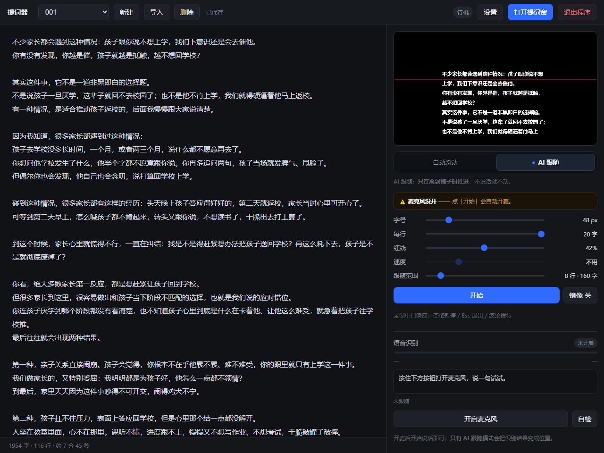
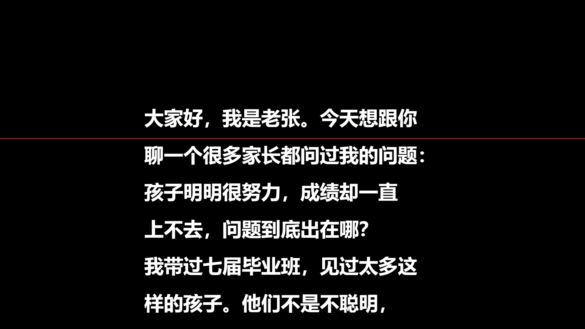
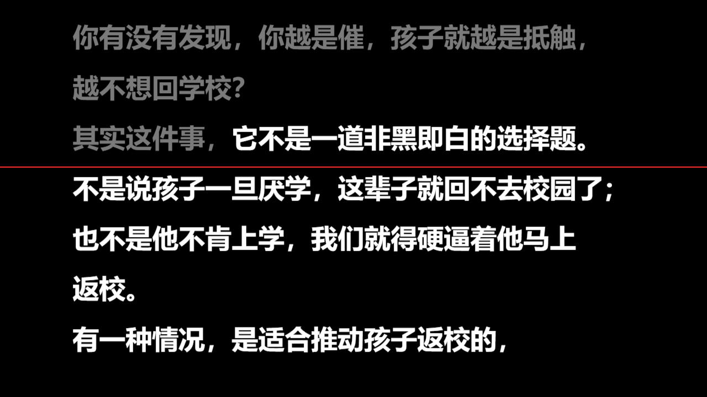
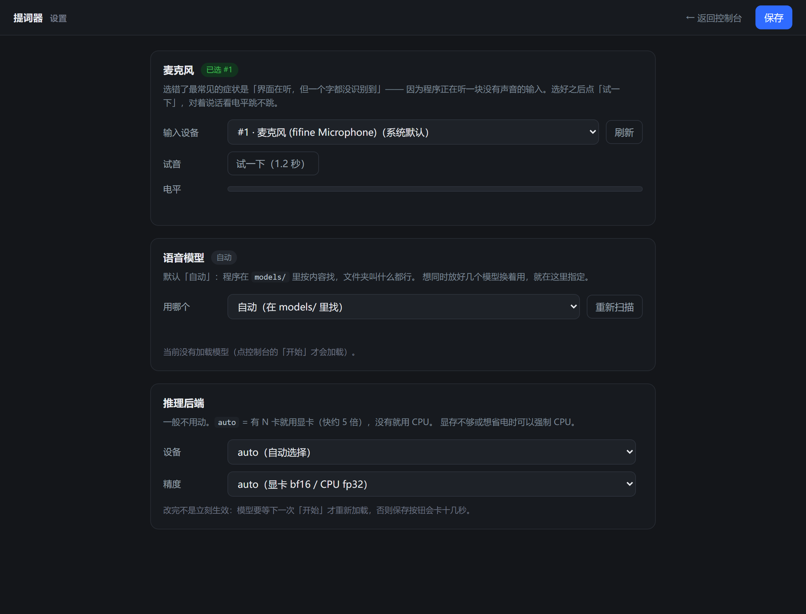

# AI 语音跟随提词器

**麦克风在听你念，念到哪儿稿子就跟到哪儿。** 不用手拨、不用遥控器、不用第二个人举着稿子。

录口播视频用的。全本地运行：模型跑在自己的显卡或 CPU 上，**不联网、不调任何云端 API**，稿子不出本机。

| | |
|---|---|
| 当前版本 | **v2.2.4** |
| 平台 | Windows 10 / 11（64 位） |
| 许可证 | [AGPL-3.0](LICENSE) |
| 语音模型 | [Qwen3-ASR-0.6B](https://github.com/QwenLM/Qwen3-ASR)（Apache 2.0，独立作品） |
| 安装包体积 | 13 MB（模型和 torch 在安装时按需下载） |

> 完整开发记录在 [`docs/AI提词器-开发规划-v2.0.md`](docs/AI提词器-开发规划-v2.0.md)，含走过的弯路和被否掉的方案，原样公开。

---

## 目录

- [先装哪个](#先装哪个)
- [第一次打开](#第一次打开)
- [它长什么样](#它长什么样)
- [两种推进方式（二选一）](#两种推进方式二选一)
- [语音模型：开发者用的是哪款](#语音模型开发者用的是哪款)
- [设置：换麦克风、换模型](#设置换麦克风换模型)
- [管理稿件](#管理稿件)
- [快捷键](#快捷键)
- [出问题了怎么查](#出问题了怎么查)
- [从源码跑](#从源码跑)
- [目录结构](#目录结构)
- [开发与自检](#开发与自检)
- [技术方案](#技术方案)
- [已知限制](#已知限制)
- [许可证](#许可证)

---

## 先装哪个

### 推荐：装安装包

从 [Releases](../../releases) 下载 **`AITeleprompter-2.2.4-Setup.exe`**（13 MB），双击。

装的过程会问你四件事：

| 步骤 | 说明 |
|---|---|
| 安装位置 | 默认在 `%LOCALAPPDATA%\Programs\AITeleprompter`，**装哪个盘由你定**。沿用上次的目录会复用已下载的依赖；换新目录要重新下 |
| 运行方式 | **显卡加速**（有 NVIDIA 卡选这个）或 **仅 CPU**。差别是下面那 2.6 GB 与 240 MB |
| 附加任务 | 勾「创建桌面快捷方式」；勾「现在就下载模型」也可以，不勾以后再说 |
| 开始安装 | 出现一个独立的进度窗口，**可以暂停、可以取消**，最小化和关闭按钮都是真的能用 |

装的时候要下载多少（只算一次，装在本地）：

| 装什么 | 显卡加速 | 仅 CPU |
|---|---|---|
| PyTorch（跑模型的引擎） | 约 2.6 GB | 约 240 MB |
| 语音模型 Qwen3-ASR-0.6B | 1.8 GB | 1.8 GB |

几条实际会用到的规则：

- **中途取消不会白下。** 已经下到一半的包留在原地，重新运行安装包会接着下，**只补没完成的那部分**，不会从零开始。
- **重装 / 升级也一样**：它会先体检这台机器上已经有什么，装好了的整段跳过 —— torch 版本对了就不再下 2.6 GB。
- **装之前先把提词器退出。** 如果程序还开着，安装器会提示一次「请先退出提词器」（因为 python 运行时的文件正被占用，删不掉）。控制台右上角有「退出程序」按钮，点一下就行；找不到控制台就去任务管理器结束 `pythonw.exe`。
- 装完可以在完成页直接点「立即启动」，也可以勾「查看安装结果」看一份几百字节的摘要。

**卸载**：Windows 设置 →「应用」→ 找到「AI 提词器」卸载。卸载时它会**单独问你两次**：要不要删你写的稿子和界面设置、要不要删那 1.8 GB 模型。默认都是「否」。

### 也可以不装：从源码跑

需要机器上先有 Python 3.10+（实测 3.13）。见 [从源码跑](#从源码跑)。

---

## 第一次打开

双击桌面上的 **「AI 提词器」**。大约一秒后浏览器会自己打开 `http://127.0.0.1:8756`。

> **看不到黑色命令行窗口，是正常的。** 程序用 `pythonw.exe` 启动，本来就不分配控制台。
> 判断"起来了没有"看浏览器有没有打开页面，不是看有没有黑框。

**怎么关掉它**：控制台页面右上角的 **「退出程序」**（红色按钮）。点完服务立刻停、进程退出，界面会盖上一层「提词器已退出」，那个标签页可以直接关。

> 以前只能去任务管理器里结束 `pythonw.exe`，现在不用了。这个按钮就是替掉那一步的。

日常最顺的一条路：贴稿 → 选推进方式 → 点「打开提词窗」→ 把提词窗拖到摄像头附近那块屏幕 → 按空格开始。

---

## 它长什么样



左边贴稿子，右边是 16:9 实时预览和全部参数。上面那个分段开关决定**谁来推动文字**。

提词窗有两个状态 —— **准备态**（全白，红线停在第一行底下）和**跟读中**（念过的字变灰）：

| 准备态 | 跟读中 |
|---|---|
|  |  |

黑底白字，一条红线横在「当前要念的那一行」下方：

- 红线**以上**的字 = 已经念过的，全部变灰 → 余光扫一眼就知道进度
- 红线**以下**的字 = 还没念的，保持白色 → 提前看得到下一句
- 当前这一行里念到哪个字，哪个字当场变灰

红线高度可调（15%–70%），字号可调（24–160 px），每行字数可调（8–20 字）。**录制中这些全部锁死**，只剩空格（暂停）、Esc（退出）、滚轮（手动拨行）有效 —— 刻意的，防止录到一半手抖改坏版式。

---

## 两种推进方式（二选一）

控制台最上面那个开关决定谁来推动文字，两者互斥，不会同时生效：

| 模式 | 文字怎么走 | 什么时候用 |
|---|---|---|
| **自动滚动** | 按「速度」匀速推进（字/秒），不碰麦克风 | 练手、语速稳定的稿子、不想开麦 |
| **AI 跟随** | **只有识别到稿子里的内容才动**，没说话就停在原地 | 录口播。语速快慢、停顿、重念都不影响 |

**AI 跟随不需要手动开麦**：选好模式点「开始」就行，它自己开。
首次要等 10–20 秒（导入 torch + 加载权重 + 预热），这期间状态条会显示进度，而且**麦克风已经先开了** —— 这段时间说的话不会白说，加载完会补上最近 4 秒。之后再开关只要 1–2 秒（模型已在内存）。

模式选择会记住，下次打开还是这个。

### AI 到底有没有在干活？看那一行状态

「稿子不动」和「程序坏了」从外面看是一样的，所以 AI 模式下会有一行字直接说清处境：

| 状态条 | 意思 | 你该做什么 |
|---|---|---|
| ⚠️ 麦克风没开 | 听不到你，稿子不会动 | 点「开始」，会自动开 |
| ⏳ 正在加载语音引擎 | 首次 10–20 秒 | 等，**不用重新点开始** |
| 🎤 在听，但还没听到你说话 | 引擎好了，没收到声音 | 看音量条动不动；不动就是麦没声 / 静音 / 选错设备 |
| 🎧 听到了，但对不上稿子 | 识别到了，但和当前位置差太远 | **用滚轮把当前行拨到正在念的地方** |
| ✅ 跟随中 · 置信度 0.xx | 正常工作 | — |

---

## 语音模型：开发者用的是哪款

**推荐的外部依赖是语音识别模型：[`Qwen3-ASR-0.6B`](https://github.com/QwenLM/Qwen3-ASR)。** 只是推荐 —— 换别的也能跑，见下面那一段。

| 项 | 值 |
|---|---|
| 全名 | Qwen3-ASR-0.6B |
| 出品 | 阿里巴巴通义千问团队（Qwen） |
| 许可证 | **Apache 2.0**（可商用、可修改、可再分发，需保留版权与许可声明） |
| 参数量 | 0.6B |
| 权重体积 | 约 1.8 GB，共 10 个文件（其中 `model.safetensors` 单文件 1.75 GB） |
| 下载地址 | [ModelScope](https://modelscope.cn/models/Qwen/Qwen3-ASR-0.6B)（国内快） / [Hugging Face](https://huggingface.co/Qwen/Qwen3-ASR-0.6B) |
| 在项目里的位置 | `models/Qwen3-ASR-0.6B/`（安装版里是安装目录下的 `models\`） |

> 理论上来说任何模型都能兼容，根据你电脑硬件情况装载即可，不过过于小的模型识别速度可能有些狼狈，需要注意，我也没咋试别的模型兼容性，不过这年头手头上应该都有 WorkBuddy 或者 DSH 之类的智能体，一句话改改就行。

### ⚠️ 最容易混的一点：模型和 torch 是两样东西

| | 是什么 | 体积 | 干什么 |
|---|---|---|---|
| **模型** `Qwen3-ASR-0.6B` | 一堆**数据文件**（`model.safetensors` 等 10 个） | 1.8 GB | 装着「中文语音 → 文字」这件事的知识 |
| **torch**（PyTorch） | 一个**软件引擎**，普通 Python 库 | 约 2.5 GB | 把模型跑起来的计算框架，自己不懂任何语言 |

所以「换成 CUDA 版 torch」= **换引擎**（让它用显卡算，而不是用 CPU 算），**模型文件一个字节都没动**。两者版本各管各的：模型是 `Qwen3-ASR-0.6B`，引擎是 `torch==2.14.0+cu126` —— `+cu126` 就是「按 CUDA 12.6 编译」的标记。没有 N 卡的人装 CPU 版 torch，**用的还是同一个模型**，只是慢约 5 倍。

### 为什么权重不在这个仓库里

`model.safetensors` 单个文件 1.75 GB，而 **GitHub 单文件硬上限是 100 MB**，推上去必定失败。所以 `.gitignore` 里排除了 `models/`，权重单独下载 —— **这不是隐藏，是平台限制**。安装版直接在安装时下到安装目录，不经过仓库。

### 识别之外的部分没有用任何模型

没有调用大语言模型、没有云端 API、没有账号。所谓「AI 跟随」是把**你已知的稿子**和**识别出来的文字**做受限对齐（拼音 + 半全局 DTW），比通用语音识别定位准得多，实测 0.66 ms 一次。原理见 [技术方案](#技术方案)。

---

## 设置：换麦克风、换模型

控制台右上角 **设置** 进入。改完点「保存」，**下一次「开始」时生效**。正在识别时这一页会整体锁住，和「录制中不能删稿」是同一套规矩：正在用的东西不许中途抽走。



### 麦克风

下拉里列出系统里所有能录音的输入设备，标着「（系统默认）」的就是 Windows 当前默认。

不确定该选哪个？**点「试一下」**，对着说话看「电平」条跳不跳：

| 电平 | 什么意思 | 怎么办 |
|---|---|---|
| 几乎不动（< 0.002） | 这个设备没收到声音 | 选错设备了 / 麦克风静音 / 没插好 |
| 0.002 – 0.02 | 有声音但偏小 | 录的时候离近一点，或在系统里把输入音量拉高 |
| > 0.02 | 正常 | 就用它 |

这张表解决的是最烦的一种情况：**「程序在听」和「程序听不到」在界面上长得一模一样**，只能靠猜。现在当场就能看见。

### 语音模型

默认「自动」—— 程序在 `models/` 里**按内容找**，不认文件夹名字：

```
models/Qwen3-ASR-0.6B/          ← 默认位置，优先
models/随便叫什么/               ← 改名也行
models/下载/Qwen3-ASR-0.6B/     ← 压缩包多套了一层也行
models/                          ← 直接把文件铺进 models/ 也行
```

判定只看两样：那个目录里**同时有** `config.json` 和权重文件（`model.safetensors` / `pytorch_model.bin` / 分片的 `model-*-of-*.safetensors`）。

想同时放好几个模型换着用：全塞进 `models/`，这里就会列出来让你挑；也可以选「手动指定路径…」填一个 `models/` 之外的绝对路径。

> 想固定用别处的权重，也可以设环境变量 `TELEPROMPTER_MODEL` 指向那个目录 —— 一旦设了，就只认那一个。

### 推理后端

一般不用动。`auto` = 有 N 卡就用显卡（快约 5 倍），没有就 CPU。显存不够、或想省电安静跑，就强制 `cpu`。

> **保存不是立刻加载模型**：那会在点保存的瞬间卡 10–20 秒（导入 torch），界面看着像死了。所以只改参数，等你下次点「开始」才真正换。换麦克风也一样。

---

## 管理稿件

稿子都存在 `data/scripts/`，一篇一个 `.md`。界面上能做四件事：

| 操作 | 怎么用 |
|---|---|
| 新建 | 头部「新建」，输个名字 |
| 导入 | 头部「导入」，选 `.txt` / `.md`，文件名就是稿件名 |
| 删除 | 头部「删除」，删掉当前选中的这篇 |
| 改稿 | 直接在左边编辑，停手 0.8 秒自动保存 |

删除前会把稿件名和字数摆进确认框 —— **这个动作不可撤销，没有回收站**。两条保护：

- **录制中不能删**（按钮直接锁死）：正在念的内容瞬间失效会很危险。
- 删掉的正好是当前稿件时，自动切到剩下的第一篇；全删光了会自动补回示例稿。

> 稿件名不能含 `/ \ : * ? " < > |`，也不能以点开头 —— 这些字符拼不出合法文件名，更麻烦的是能从 `data/scripts/` 里跳出去。后端会挡掉。

**换电脑 / 重装要带走的东西只有 `data/`**（稿子和界面设置）和 `models/`（模型）。

---

## 快捷键

| 键 | 什么时候 | 作用 |
|---|---|---|
| `空格` | 准备态 | 开始 |
| `空格` | 录制态 | 暂停 / 继续 |
| `Esc` | 录制态 | 退出到准备态 |
| 滚轮 | 录制态 | 当前行上/下拨一行 |
| `Ctrl` + `=` / `-` | 准备态 | 字号 ±2 |
| `F11` | 任意 | 全屏 |

准备态的快捷键在录制态会被拦下来 —— 这条边界就是防误触的机制。

---

## 出问题了怎么查

### 先看这三个地方

| 文件 | 在哪 | 是什么 |
|---|---|---|
| `install-result.txt` | 安装目录根 | 安装结果摘要（几百字节），装完勾「查看安装结果」就是用记事本打开它 |
| `install.log` | 安装目录根 | 安装全过程日志，下载和 pip 的细节都在里面 |
| `data\launch.log` | 安装目录下 `data\` | **每次启动都会追加一段**：用的哪个解释器、目录、有没有控制台。程序"点了没反应"的时候先看它 |

### 常见情况

| 你看到的 | 真正的原因 | 怎么办 |
|---|---|---|
| 双击快捷方式**没有黑框** | 正常。走的是 `pythonw.exe`，本来就不分配控制台 | 看浏览器有没有打开 `http://127.0.0.1:8756` |
| 浏览器没弹出来，但程序像是起来了 | 默认浏览器没关联，或被拦了 | 手动打开 `http://127.0.0.1:8756`；这种情况下程序也会弹窗把地址告诉你 |
| 双击了，**什么也没发生** | 启动期就出错了，而 pythonw 没有 stderr | 看 `data\launch.log` 末尾，会写出完整调用栈；真起不来时会弹窗告诉你原因 |
| 安装时弹出「AI 提词器 正在运行」 | 程序还开着，python 运行时的文件被占用 | 控制台右上角点「退出程序」，或任务管理器结束 `pythonw.exe`，再点「确定」 |
| 安装时提示「看起来还在运行」，但你确定关了 | 上一份进程还没退干净 | 再点一次「下一步」重试 |
| 提示 8756 端口被占 | 上一个实例没关干净 | 关掉所有实例重来；或设环境变量 `TELEPROMPTER_PORT=8757` 换端口 |
| 界面能开，点「开始」报缺 torch / 找不到模型 | 引擎或权重没就位 | 重新运行安装包（它会补齐）；或按 [设置](#设置换麦克风换模型) 检查模型目录 |
| 界面正常，但字一动不动 | 见 [AI 到底有没有在干活](#ai-到底有没有在干活看那一行状态) | 九成是没开麦、麦没声，或当前位置离你念的地方太远 |
| 装完打不开，想彻底重来 | — | 卸载后重新装；`data\` 和 `models\` 会被单独询问，不删就还在 |

> 💡 **界面和语音是两层，别混着查。**
> `fastapi` / `uvicorn` / `numpy` / `sounddevice` / `pypinyin` / `websockets` 是「能打开界面」的底线；
> `torch` / `transformers` / `qwen-asr` 只有点「开始」加载模型时才 `import`。
> 所以「界面打不开」和「点了开始没反应」是两码事，排查方向完全不同。

---

## 从源码跑

不装安装包、想改代码或打包给别人时走这条。

**前置**：Windows 10/11 + Python **3.10+**（实测 3.13）。

```bash
git clone https://github.com/BBsaba/ai-follow-teleprompter.git
cd ai-follow-teleprompter

# 1) 依赖（建议先建虚拟环境，别污染系统 Python）
python -m venv .venv
.venv\Scripts\activate
pip install -r requirements.txt

# 2) 模型权重（1.8 GB，支持断点续传，中断了重跑即可）
python tools/download_model.py

# 3) 启动
python run.py        # 或者双击 start.bat
```

`start.bat` 会按顺序找解释器：`.venv\Scripts\python.exe` → 环境变量 `TELEPROMPTER_PYTHON` → PATH 里的 `python`，第一行会打印它选了哪个。

### 关于 torch 的两个版本

`requirements.txt` 里写的 `torch>=2.4` 从 PyPI 装到的是 **CPU 版**（实测 RTF 0.30 能跑）。想用显卡加速，按 [pytorch.org](https://pytorch.org) 给的命令装 CUDA 版，例如：

```bash
pip install torch --index-url https://download.pytorch.org/whl/cu126
```

| 版本 | 体积 | 4 秒音频耗时 | 适合 |
|---|---|---|---|
| **CUDA 12.6** | 约 2.5 GB | 约 0.24 秒（RTF 0.06） | 有 NVIDIA 显卡 |
| **CPU** | 约 200 MB | 约 1.2 秒（RTF 0.30） | 任何机器，慢但够用 |

开发机是 RTX 3060 Ti 8 GB + CUDA 12.6，上表第一行是它实测的。选错了也不用重来：`config.ASR["device"] = "auto"` 会先试 cuda，不行就回落 cpu，不报错。

> ⚠️ **`requirements.txt` 里那几条版本是锁死的，不要手动升级。**
> `transformers==4.57.6` / `huggingface-hub<1.0` / `qwen-asr==0.0.6` 互相咬得很紧，
> 放宽任何一条都会报 `check_model_inputs` 或版本冲突。踩坑过程见开发文档 §11.4。

### 桌面快捷方式（可选）

```bash
python tools/make_shortcut.py                 # 建到当前用户桌面（无控制台窗口）
python tools/make_shortcut.py --with-console  # 指向 start.bat，保留黑框，开发时看报错
python tools/make_shortcut.py --show          # 看看现在指向哪
python tools/make_shortcut.py --remove        # 删掉它
python tools/make_shortcut.py --all-users     # 建到公共桌面（需管理员）
```

默认指向 **`pythonw.exe` + `run.py`**，双击不弹黑框 —— 和安装版是同一种启动方式。
找解释器的顺序和 `start.bat` 一致：`.venv\Scripts\pythonw.exe` → `%TELEPROMPTER_PYTHON%`
旁边的 `pythonw.exe` → 当前解释器旁边的。都找不到才退回 `start.bat`（那样会有黑框）。

**不需要 `pip install pywin32`**：`tools/win_shortcut.py` 用 ctypes 直接调 Windows 的
`IShellLinkW` / `IPersistFile`，和资源管理器建快捷方式走的是同一套 API。

> 从源码跑的人常犯一个错：先跑 `make_shortcut.py`，再手动把快捷方式改成别的解释器。
> 不用改，`--show` 会告诉你它到底指向哪个 `pythonw.exe`。

图标 `assets/teleprompter.ico` 由 `tools/make_icon.py` 生成（需要 pillow，同样只有生成时用）：黑底 + 三行白字 + 一根红线，就是提词窗本身的样子。

### 打包发给别人

两条路是**两套产物**，差别只在模型在不在里面：

```bash
python tools/package.py                # → dist/AITeleprompter-<日期>-code.zip    约 250 KB
python tools/package.py --with-model   # → dist/AITeleprompter-<日期>-full.zip    1.8 GB
```

`--list` 可以先看看会打进哪些文件，不生成 zip。它**会自动排除 `data/`**（你的稿子和偏好）；真想连稿子一起发，加 `--include-data`。

**发人用 `full`**：对方解压 → 双击 `setup.bat`（建 venv、装依赖）→ 双击 `start.bat`。模型已经在里面了，不用再下，只要求对方机器上有 Python 3.10+。

---

## 目录结构

```
ai-follow-teleprompter/
├── app/                    后端
│   ├── config.py           所有可调数值集中在这里
│   ├── script.py           稿件解析：清洗 → 切行 → 注音
│   ├── session.py          状态机 + 位置推进
│   ├── motion.py           位置平滑（非对称低通）
│   ├── align.py            拼音 + 半全局 DTW 对齐器
│   ├── audio.py            麦克风采集（16 kHz 环形缓冲）+ 设备枚举 / 试音
│   ├── asr.py              Qwen3-ASR 推理封装
│   ├── model_finder.py     按内容找模型目录（不认死路径）
│   ├── listener.py         滑窗循环：音频 → 识别 → 广播
│   ├── store.py            稿件与设置落盘
│   ├── shutdown.py         退出开关（/api/quit 的唯一出口）
│   └── server.py           FastAPI + WebSocket
├── web/                    前端（原生 JS，零构建）
│   ├── console.*           控制台
│   ├── prompter.*          提词窗
│   └── settings.*          设置页
├── installer/              安装包源码
│   ├── AI提词器.iss        Inno Setup 脚本（页面、组件、Pascal 逻辑）
│   └── check_iss_comments.py
├── tools/
│   ├── build_installer.py  做安装包（下载便携 Python + 装 pip + 编译 iss）
│   ├── prep-ui.ps1         安装时的进度窗口（PowerShell + WinForms）
│   ├── pip_progress.py     替安装器跑 pip，把百分比写进状态文件
│   ├── check_env.py        装机前体检，决定哪些步骤可以整段跳过
│   ├── download_model.py   断点续传下载权重
│   ├── package.py          打成 zip（代码版 / 带模型版）
│   ├── make_icon.py        生成 assets/teleprompter.ico（需 pillow）
│   ├── win_shortcut.py     建 .lnk：ctypes 直调 IShellLinkW，无需 pywin32
│   └── make_shortcut.py    建/看/删桌面快捷方式（默认指向 pythonw，无控制台）
├── models/                 模型权重（不进 git，1.8 GB）
├── data/                   你的稿子和偏好（不进 git）
├── docs/                   开发全过程记录 + README 用的截图
├── tests/                  脚本式测试，唯一入口 run_all.py
├── assets/teleprompter.ico
├── run.py                  启动入口
├── setup.bat               源码版首次安装：建 .venv + 装依赖
├── start.bat               源码版双击启动（带控制台，看得出报错）
├── LICENSE                 AGPL-3.0
└── requirements.txt
```

**所有路径都是相对 `app/config.py` 的 `ROOT` 推导的**，整个文件夹搬到哪都能跑。端口默认 8756，想同时跑两份（比如试一下新解压的副本）设环境变量 `TELEPROMPTER_PORT`。

---

## 开发与自检

### 跑测试

```bash
python tests/run_all.py          # 能跑的全跑
python tests/run_all.py --fast   # 只跑不需要服务和模型的（十几秒出结果）
```

| 文件 | 测什么 | 前置 |
|---|---|---|
| `test_script.py` | 清洗、硬切行、避头规则、位置平滑 | — |
| `test_align.py` | DTW 对齐五类情况 + 会话推进 + 模式互斥 | — |
| `test_server.py` | 稿件 id 安全、删除、AI 模式开始会不会开麦 | — |
| `test_model_finder.py` | 模型目录按内容发现：改名、多套一层、直接铺开、显式指定严格性 | — |
| `test_settings.py` | 麦克风编号校验、模型路径校验、换设备不白卸载、录制中锁设置 | — |
| `test_follow_e2e.py` | 样例音频 → 识别 → 对齐 → 位置 | 模型 |
| `test_live.py` | 假麦克风灌进真循环，看位置会不会被推着走 | 模型 |
| `test_ws.py` | WebSocket 协议、状态机、暂停/退出 | 服务在跑 |
| `test_ui.py` | 控制台联动、渲染、窗口自适应、按键拦阻、AI 状态条 | 服务在跑 + playwright |

实测：`--fast` **194 项**（5 个文件）；完整套件 **220 项**（8 个文件，需服务在跑）。
`test_ui.py` 要额外装 playwright，没装会跳过并说明原因 —— 跳过的是它一个，其余照跑。

```bash
pip install playwright
python -m playwright install chromium    # 只需一次，约 150 MB
```

`run_all.py` 会自己检查前置，缺什么就跳过并说明原因，**不会假装通过**。

> ⚠️ **别用 `pytest tests/`。** 这些测试是脚本式的（自己维护 `OK/FAIL` 计数，靠 `check()` 断言，没有 `assert`），pytest 会把它们收成空壳函数、跑完报「14 passed」—— 假绿。`tests/conftest.py` 里已经显式挡掉了。

### 做安装包

需要 **Inno Setup 7**（`ISCC.exe`），其余全自动：

```bash
python tools/build_installer.py --version 2.2.5
```

它会做三件事：

1. 下载 Python 3.13 embeddable 包，解成便携运行时，装好 pip，并写好 `python313._pth`（**少了 `..` 这一行，装完 `import app` 必失败**）
2. 把 `app/ web/ tools/ run.py requirements.txt` 拷进 payload，`prep-ui.ps1` 强制转成 UTF-8 带 BOM
3. 调 ISCC 编译，产物落在 `dist/`

调试代码改动时加 `--skip-runtime` 复用已有的 `build/payload/python`，几秒就能出包。

> 安装包**不含** torch、transformers 和模型权重 —— 那些在用户机器上按需下载。所以包只有 13 MB。

> ⚠️ **往 GitHub Release 传的时候要改成 ASCII 文件名。** `build_installer.py` 本地产出的
> 是 `AI提词器-<版本>-安装程序.exe`，但 Release 附件名不支持非 ASCII —— 传上去中文会被
> 直接替换掉，`AI提词器-2.2.4-安装程序.exe` 会变成 `AI.-2.2.4-.exe`，PATCH 改名也救不回来
> （接口返回 200，名字不变）。所以 release 上用的是 `AITeleprompter-<版本>-Setup.exe`，
> 本地文件保持中文名。两处文件名因此不一致，是正常的。

---

## 技术方案

| 环节 | 做法 | 为什么 |
|---|---|---|
| 断行 | 按字数**硬切行**，行尾 30% 内优先在标点处断，并遵守中文**避头规则** | 红线贴行底、按行染色、滚轮拨行，三者都需要显式的行边界；CSS 自然折行拿不到行边界 |
| 渲染 | 红线固定，**只平移文字层** | 每帧只改一个 `translateY`，不触发重排，稳定 60 fps |
| 染色 | 行级（上方整行灰）+ 字级（当前行逐个灰） | 一眼看出「念到哪」 |
| 屏边 | 渐隐区高度**按行几何精算**，只盖住被屏边切开的半行 | 否则边缘会出现被横切的半排大字，像 bug |
| 尺寸适配 | 一切用**比例**，`ResizeObserver` + rAF 合并，resize 期间关过渡 | 拖窗口、F11、第二屏、125% 缩放都不能让红线脱靶 |
| 识别 | Qwen3-ASR-0.6B（transformers 后端） | 中文强、0.6B 够快、Apache 2.0 |
| 对齐 | 拼音 + 半全局 DTW，声母/韵母两级代价 | 稿子是已知的，这是受限匹配，比通用 ASR 精确得多；实测 0.66 ms/次 |

---

## 已知限制

- **两种推进方式二选一**：自动滚动（按速度匀速走）或 AI 跟随（只在念到稿子时走）。控制台上方切换，选择会记住。
- AI 模式下位置更新约 **每秒 2–3 次**（GPU）。一行 14 字要念 3 秒，够用；但字级变灰是"跳着"走的，不是逐帧流过去。
- 对齐窗口是「当前位置前 40 字、后 100 字」，**跳读超过 100 字**需要滚轮帮一下。
- **改稿后位置回到第 1 字**（排练到一半改稿会丢位置，这是刻意的简化）。
- 编辑器是纯文本，不支持图片、表格、角色分色。
- **字号上限受屏宽约束**，1080p 大约 127 px。
- **硬切行可能切断英文单词**；口播稿英文占比低，接受。
- **一次只用一个模型**：换模型 = 卸载重载，第一次「开始」要等 10–20 秒，不能两个模型同时待命。
- **不处理麦克风热插拔**：正在用的设备被拔掉会在下次开麦时报错，不会自动切到别的设备。
- **采样率优先要 16 kHz**：设备不支持才退回它自己的默认速率再重采样，不提供手动指定。
- **服务在后台没有窗口**（pythonw）。要停就用控制台右上角的「退出程序」；那个按钮万一失灵，再去任务管理器结束 `pythonw.exe`。

---

## 许可证

**本项目以 [GNU Affero General Public License v3.0](LICENSE)（AGPL-3.0）发布。**

```
Copyright (C) 2026 公功供工
```

用一句话说清你能做什么：

| 你想做的事 | 允许吗 | 条件 |
|---|---|---|
| 自己用、录视频（**包括商业视频、带货、付费课程**） | ✅ 随便用 | 无 |
| 改代码、加自己的功能 | ✅ 随便改 | 无 |
| 在公司 / 工作室内部用 | ✅ 可以 | 无 |
| 打包发给朋友、放到自己的网盘 | ✅ 可以 | 附带许可证与源码 |
| **改完之后分发（包括只提供网络服务）** | ✅ 可以 | **必须同样以 AGPL-3.0 公开你的修改** |
| 把改过的版本闭源卖钱 | ❌ 不行 | — |
| 拿它当闭源商业产品卖 | ❌ 不行 | — |

**最关键的一条是「改了要开源」**：AGPL 第 3 条要求，即使你只是把改过的版本架成网络服务让别人用，也必须向使用者提供修改后的源码。所以「GitHub 上的东西只能作者自己改」这个诉求，在开源的定义下无法成立 —— OSI 开源定义第 3 条明确要求允许衍生作品。

但 AGPL 给了最接近的效果：任何人做的改进都必须回流公开，**没有人能拿你的代码做出一个闭源产品来跟你竞争**。而你是版权人，你自己不受这些限制。

> 为什么不是 MIT / Apache-2.0？那两者允许他人闭源改造后商业分发，做不到「防倒卖」。
> 为什么不是 SSPL / BUSL？它们没通过 OSI 认证，不算开源，很多公司内部政策直接禁用。

### 关于语音模型的许可

`Qwen3-ASR-0.6B` 是**另一个独立作品**，由阿里巴巴以 **Apache 2.0** 发布，**不受本项目 AGPL 约束** —— 你在 AGPL 之下再分发本项目时，模型权重仍按 Apache 2.0 走，保留其版权与许可声明即可（`models/` 里的 `LICENSE` 文件不要删）。

---

## 致谢

- 识别模型：[Qwen3-ASR](https://github.com/QwenLM/Qwen3-ASR)（阿里巴巴通义千问，Apache 2.0）
- 推理框架：[PyTorch](https://pytorch.org/) / [Transformers](https://github.com/huggingface/transformers)（BSD-3 / Apache 2.0）
- Web 服务：[FastAPI](https://fastapi.tiangolo.com/)（MIT） / [uvicorn](https://www.uvicorn.org/)（BSD-3）
- 安装程序：[Inno Setup](https://jrsoftware.org/isinfo.php)（自由使用）
